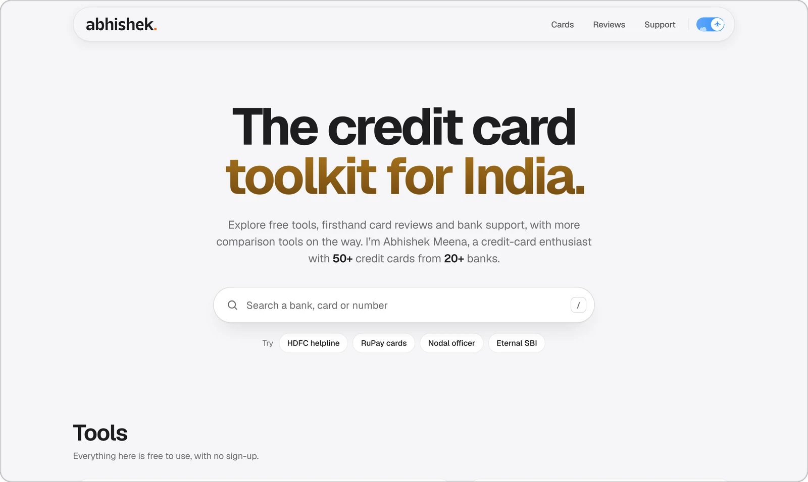
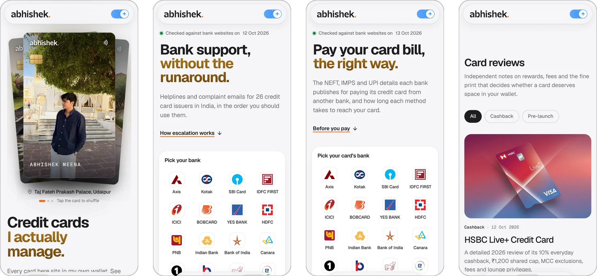

<a href="https://avhishek.in/">
  <picture>
    <source media="(prefers-color-scheme: dark)" srcset="docs/readme/wordmark-dark.svg">
    
  </picture>
</a>

### The credit card toolkit for India.

avhishek.in is an independent website for people who use credit cards in India. It collects the things that are tedious to find on bank websites (helplines, escalation contacts and bill-payment details for 26 issuers) next to firsthand card reviews and the cards Abhishek Meena actually holds.

**[avhishek.in](https://avhishek.in/)** &nbsp;·&nbsp; [Card portfolio](https://cards.avhishek.in/) &nbsp;·&nbsp; [Reviews](https://avhishek.in/card-reviews) &nbsp;·&nbsp; [Bank support](https://avhishek.in/bank-support) &nbsp;·&nbsp; [Pay a card bill](https://avhishek.in/pay-credit-card-bill)

<br>

<picture>
  <source media="(prefers-color-scheme: dark)" srcset="docs/readme/preview-home-dark.webp">
  
</picture>

<br>

## Explore the site

**[Home](https://avhishek.in/)** &nbsp;`avhishek.in`<br>
One search box across banks, cards, helpline numbers and reviews, with live counts and a way into every tool. Press <kbd>/</kbd> to jump to it.

**[Credit card portfolio](https://cards.avhishek.in/)** &nbsp;`cards.avhishek.in`<br>
The 51 cards from 22 issuers that Abhishek holds, grouped by bank. Search by card, bank or use case, or narrow the list to lifetime-free, RuPay, cashback or partner cards.

**[Card reviews](https://avhishek.in/card-reviews)** &nbsp;`/card-reviews`<br>
Long-form reviews written from use, not press releases: rewards, fees, exclusions and the fine print. Currently HSBC Live+, Eternal SBI and the Slice Business card.

**[Bank support directory](https://avhishek.in/bank-support)** &nbsp;`/bank-support`<br>
Customer care numbers and complaint emails for 26 card issuers, laid out in the order you should escalate: customer care, the nodal officer, the principal nodal officer, and finally the RBI Ombudsman.

**[Credit card bill payment](https://avhishek.in/pay-credit-card-bill)** &nbsp;`/pay-credit-card-bill`<br>
How to pay each of the 26 issuers from another bank: NEFT and IMPS details, UPI ID formats, app and net-banking paths, and how long each method takes to post. Each bank's details link to the official pages they came from.

<br>

<picture>
  <source media="(prefers-color-scheme: dark)" srcset="docs/readme/preview-tools-dark.webp">
  
</picture>

## Features

- **Search everywhere it helps.** Site-wide search on the homepage, plus dedicated search on the portfolio, bank support (bank, number or email) and bill payment (bank, IFSC or UPI) pages.
- **Copy and tap.** One-click copy for IFSC codes, UPI formats, numbers and emails; tap-to-call and tap-to-email on phones.
- **Sourced data.** Payment details are read from each bank's own website or documents, with a source link and a visible "checked on" date.
- **Light and dark themes.** The first visit follows the system setting; the choice is remembered after that.
- **Built for phones.** Layouts scale down to small screens, where navigation moves to a bottom tab bar.
- **Accessible by default.** Skip links, visible keyboard focus, labelled controls, and reduced motion when the system asks for it.

## How it's built

avhishek.in is a static site with no framework and no build step in production.

| Layer | What it uses |
| --- | --- |
| Pages | Hand-written HTML. Each page is a standalone file with its own header, footer and theme script. |
| Styling | Plain CSS built on design tokens in [`assets/site.css`](assets/site.css), with self-hosted Geist and Geist Mono variable fonts. Themes switch via `data-theme` on `<html>`. |
| Behaviour | Vanilla JavaScript. Card, contact and payment data live in plain JS files under [`assets/`](assets). |
| Reviews grid | The one compiled piece: React 19 with Motion and Lucide icons in [`src/`](src), bundled by esbuild into a committed file, [`assets/card-reviews-react.js`](assets/card-reviews-react.js). |
| Hosting | Vercel serves the repository root as-is. [`vercel.json`](vercel.json) handles clean URLs, the `cards.avhishek.in` host rewrite, redirects and security headers. |

<details>
<summary><strong>Repository structure</strong></summary>

```text
.
├── home.html                   avhishek.in/
├── portfolio.html              cards.avhishek.in/
├── support.html                /bank-support
├── pay-credit-card-bill.html   /pay-credit-card-bill
├── card-reviews.html           /card-reviews
├── card-reviews/               one page per review
├── disclaimer.html, 404.html
├── assets/
│   ├── data.js                 card portfolio data
│   ├── support-data.js         bank contacts
│   ├── pay-data.js             bill payment methods and their sources
│   ├── site.css                design tokens for both themes
│   ├── card-reviews-react.js   built reviews grid (committed)
│   ├── bank-logos/  og/  reviews/  hero/
│   └── …                       per-page CSS and JS
├── src/card-reviews/           React source for the reviews grid
├── lib/motion-tokens.ts        shared motion timings
├── vercel.json                 routing, redirects and headers
├── preview-server.mjs          local server behind pnpm dev
└── docs/readme/                images used by this README
```

</details>

## Run it locally

The preview server is plain Node with no dependencies, so viewing the site needs no install.

```sh
git clone https://github.com/theavhishek/abhishek-credit-cards.git
cd abhishek-credit-cards
pnpm dev        # or: node preview-server.mjs
```

It runs on [localhost:3000](http://localhost:3000). Locally, `/` opens the card portfolio and the homepage is at [`/home`](http://localhost:3000/home); production routing and headers from `vercel.json` are not applied.

Only changes to the reviews grid in `src/` need dependencies and a rebuild:

```sh
pnpm install
pnpm build:reviews   # writes assets/card-reviews-react.js; commit it with your change
```

## Working on the site

- When a CSS or JS file changes, bump its `?v=` query in every page that loads it.
- The header and footer are repeated in each HTML page, so a navigation change goes into every page.
- Card, contact and payment data change only from the bank's official source.
- Affiliate links are always labelled. The full rules are in [`AGENTS.md`](AGENTS.md) and [`CLAUDE.md`](CLAUDE.md).

## Independence and accuracy

avhishek.in is maintained independently by Abhishek Meena. It is not affiliated with, endorsed by or sponsored by any bank, card issuer or payment network it mentions, and nothing on it is financial advice. Some pages may carry affiliate links; each one is labelled, as explained in the [disclaimer](https://avhishek.in/disclaimer).

Contact details, card terms and payment instructions change. Check anything important with the issuer's official website or app before you act on it. Bank names, logos and trademarks belong to their owners.

## Connect

[Website](https://avhishek.in/) &nbsp;·&nbsp; [X](https://x.com/the_avhishek) &nbsp;·&nbsp; [Instagram](https://www.instagram.com/avhishek.in/) &nbsp;·&nbsp; [YouTube](https://www.youtube.com/@avhishekin) &nbsp;·&nbsp; [Telegram](https://t.me/avhishekin) &nbsp;·&nbsp; [WhatsApp channel](https://whatsapp.com/channel/0029VbDBLDNL7UVPt9IYC914)

Also on [DesiDime](https://www.desidime.com/profile/the.avhishek) and [TechnoFino](https://technofino.in/community/members/the-avhishek.6612/#recent-content).
