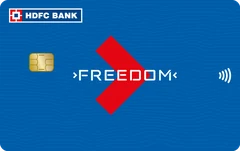
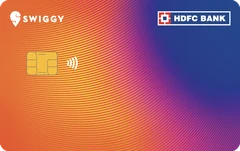
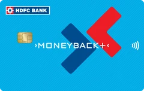
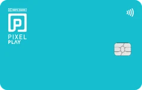
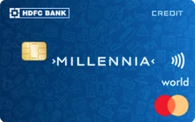
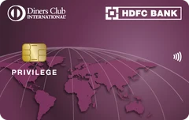
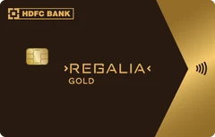
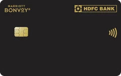
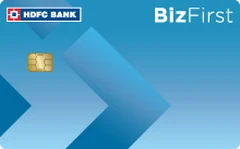
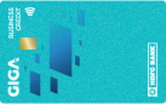

Got an HDFC Bank account but no credit card? Put money in a fixed deposit and HDFC gives you a card against it, with 90% of the FD as your limit. Even Regalia Gold and Marriott Bonvoy are on the list.

If you already hold an HDFC credit card, check your eligibility before you apply.

## The cards

| Card | Min FD | Max limit |
|---|---|---|
|  **Pixel Go** _Lifetime free · 10% off via Swiggy Dineout_ | ₹11,111 | ₹49,000 |
|  **Freedom** _Fee ₹500 · 10X on Swiggy, Uber, BigBasket_ | ₹11,111 | ₹49,000 |
|  **IndianOil** _Fee ₹500 · up to 50 L free fuel a year_ | ₹16,667 | ₹8 lakh |
|  **Swiggy Ornge** _Fee ₹500 · 5% back on Swiggy_ | ₹27,778 | ₹1.5 lakh |
|  **MoneyBack+** _Fee ₹500 · 10X on Amazon, Flipkart_ | ₹33,333 | ₹3 lakh |
|  **Pixel Play** _Lifetime free · managed in PayZapp_ | ₹55,556 | ₹8 lakh |
|  **Millennia** _Fee ₹1,000 · 5% on top apps, 1% elsewhere_ | ₹1,11,111 | ₹8 lakh |
|  **Diners Privilege** _Fee ₹1,000 · buy 1 get 1 movie tickets_ | ₹1,66,667 | ₹8 lakh |
|  **Regalia Gold** _Fee ₹2,500 · 4 points per ₹150_ | ₹3,33,333 | ₹8 lakh |
|  **Marriott Bonvoy** _Fee ₹3,000 · Bonvoy points on travel_ | ₹3,33,333 | ₹8 lakh |

For business owners:

| Card | Min FD | Max limit |
|---|---|---|
|  **Biz First** _Fee ₹500 · 55 days interest-free_ | ₹27,778 | ₹5 lakh |
|  **Giga Business** _Fee ₹500 · 3X on tax and GST payments_ | ₹27,778 | ₹8 lakh |

Max limit is the most a card can go up to, not what you get on day one.

{{limit-checker}}

## Where did Diners Black Metal and BizBlack go?

When HDFC first opened this, the FD list also showed Diners Club Black Metal and BizBlack. So many people applied that HDFC pulled both from the list, and those applications got Regalia Gold instead. HDFC never planned FD versions of these two cards; they showed up by mistake.

## How to apply

Apply on [HDFC's FD credit card page](https://applyonline.hdfc.bank.in/digital/unified-fixed-deposit-cc): pick a card, then book a new FD or link one you have.

Already have an HDFC FD? In the HDFC Bank app, open **Fixed Deposits**, pick your FD, then **FD Details**, and look for **Credit Card on FD**.

## What I'd do

- Use money you won't need for a while. You can't break the FD while the card is linked to it.
- Update your PAN with HDFC first. Without it, the FD can't go above ₹49,999.
- Pick the card that fits how you spend, not the biggest limit.
- Applied already? Tell me on [X](https://x.com/the_avhishek): which card, your FD amount, and whether you already had an HDFC card.
